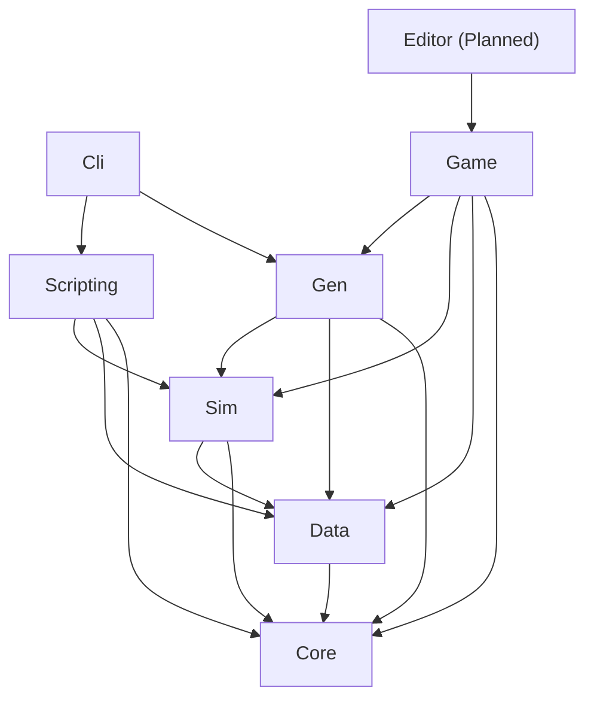

# Architecture

## Why simulation is separate from presentation

`Realm.Core`, `Realm.Data`, `Realm.Sim`, `Realm.Gen` and `Realm.Scripting` never reference Godot. They compile and run in a console app and in unit tests. That gives headless generator sweeps in CI, fast tests, and a simulation that does not depend on engine versions. Godot only renders the simulation and sends input back as commands.

## Layers

Arrows point from a project to what it may reference.

Cli also references Core, Data and Sim (omitted from the diagram for clarity). Only Game and Editor may reference Godot.

## Enforcement

`tests/Realm.Architecture.Tests` reads every `src/**/*.csproj` and fails if a project references something outside the allowed map, or references anything named Godot while not being Game or Editor. To allow a new reference, change the map in `DependencyRuleTests.cs` and update CLAUDE.md section 5 in the same change, with an ADR.

`Realm.Game` is covered: it may reference Core, Data, Sim, Gen and Scripting, nothing may reference it, and it is the only project that uses the Godot SDK. `Realm.Editor` is not covered yet because it does not exist.
