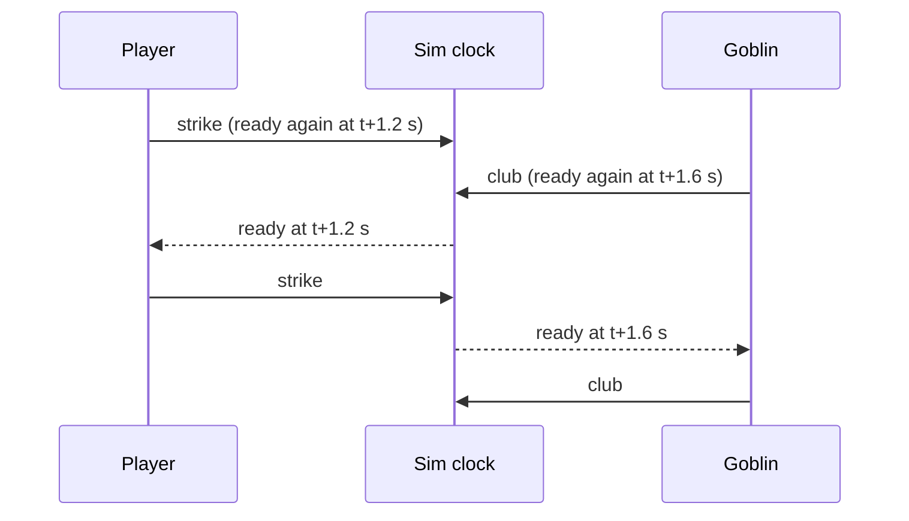
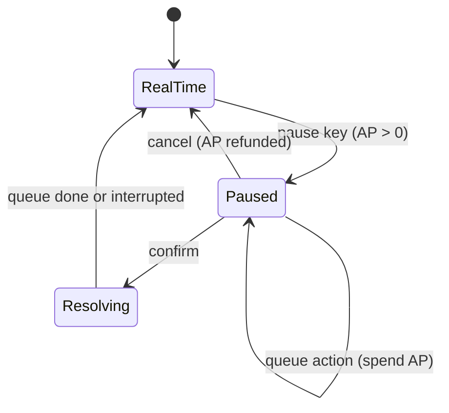

# Combat: how it is meant to work

> **Status: partly built (M5 spike).** The timeline, hit and damage rolls, area effects, conditions, the tactical pause and the balance runs exist as a standalone, tested spike: see [the combat system](../systems/combat.md) for exactly what is built. Movement, projectiles in flight, content files, death and everything on screen are still **Planned**. Decisions: [ADR 0029](../decisions/0029-combat-model-solo-character-hybrid-pause.md).

The game follows *Might and Magic VI–VIII* for the rules (recovery time, typed damage, conditions, target-based attacks) and modern Fallout's VATS for the tactical layer (a pause where you queue a few aimed actions). You play **one character**.

## One timeline

Every combatant (the player, creatures, NPC guards) has a **ready time**: the sim time when it may act next. Taking an action sets the ready time to *now + recovery*. Recovery comes from the action (a dagger stab is quicker than a greataxe swing, a spell has its own), modified by stats, skill and conditions.

In real time the clock simply runs. Holding an attack does not make you faster than your recovery allows, so there is no click-fest: speed is a character property, not a finger property.

## The tactical pause

- Pausing stops the sim clock. Nothing moves.
- You pick targets and actions. Each costs **action points** (AP) and shows its hit chance, from the same formula real time uses.
- On confirm the queue runs on the normal sim clock without waiting for recovery between the queued actions. Enemies keep acting on their own ready times, so the pause is a burst, not a free turn. Presentation shows it in slow motion.
- AP refills over time. Real-time attacks do not cost AP.

Because the pause and real time share one timeline and one formula set, they can't drift apart, and both can be tested headless.

## Resolving an attack

1. **Target-based**: you attack the selected target. The sim checks range and line of sight. No swing arcs or hit volumes.
2. **Hit roll**: one roll against a chance from attack rating minus defence, clamped to a minimum and maximum (values are data). The spike uses a straight line (75 % at equal rating, 5 % per point, 5–95 %); a smoother curve can replace it once real stats exist.
3. **Damage**: dice plus bonuses, of a **damage type** (physical, fire, cold, and so on), reduced by the target's resistance to that type.
4. **Effects**: conditions (poisoned, asleep, afraid, …), knockback, and interactions with material tags (fire against something `flammable`), using the same tag rules as crafting.

Arrows and spell projectiles are real sim entities that fly through the world, so you can step out of their way.

## Area effects hurt everyone

A fireball hits everything inside its area: enemies, bystanders and you. Hurting bystanders goes through the normal systems (factions, crime). The game shows the area before you cast so self-damage is a choice, not a surprise.

## Death

You wake at a temple. There is no gold or item loss. Time passes and the world keeps everything that happened, including the monsters that beat you.

## What is data

Weapons, spells and abilities (composed from small effects: damage, condition, projectile, area, heal), damage types and resistances, conditions, skills and their mastery ranks, AP costs and recovery times, and creature behaviour profiles. Lua is only for unusual ability hooks.

## How balance is checked

The headless `realm combat-sim` command runs thousands of fights of a scenario and reports win rate, fight lengths and health left, failing when the win rate leaves a given band: the combat equivalent of generator seed sweeps. Scenarios are still built in code; wiring the bands into CI is planned. See [Run a combat balance sweep](../how-to/run-a-combat-balance-sweep.md).

## Related
- [ADR 0029](../decisions/0029-combat-model-solo-character-hybrid-pause.md)
- [Determinism](determinism.md): every roll goes through `Rng`.
- [Architecture](architecture.md): rules live in `Realm.Sim`, presentation only animates.
