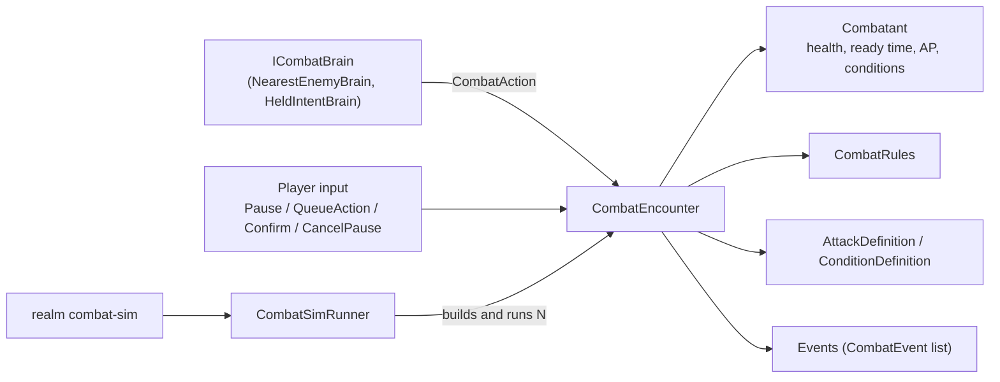

# System: Combat (`Realm.Sim.Combat`)

## 1. Purpose and scope
The combat rules from [ADR 0029](../decisions/0029-combat-model-solo-character-hybrid-pause.md): one timeline where everyone acts when their recovery allows, target-based attacks with one hit roll, typed damage and resistances, conditions, area effects that hit everyone inside, and the VATS-style tactical pause. Godot-free; it runs in tests and the CLI.

It does not move combatants, fly projectiles, read content files, save anything or draw anything. Those are listed under Status.

This is an **M5 spike**: the rules are real and tested, but the encounter is a standalone object, not yet part of `Simulation`/`SimWorld`.

## 2. Status
| Feature | State |
|---|---|
| Timeline: ready time + recovery per attack, 20 Hz ticks, ID order | Implemented |
| Hit roll (linear, clamped 5–95 %), dice damage, resistance per damage type | Implemented |
| Area attacks: no hit roll, hit every living combatant in the radius, the user included | Implemented |
| Conditions: duration, damage pulses, prevents actions, breaks on damage (poisoned, asleep as examples) | Implemented |
| Tactical pause: pause, queue with action points, cancel (refund), confirm, gap between queued actions, interrupt, AP regeneration | Implemented |
| AI: `NearestEnemyBrain` (one profile) | Implemented |
| Headless balance runs: `CombatSimRunner`, `realm combat-sim` | Implemented |
| Attacks, conditions, creatures and scenarios as YAML content with schemas and validators | Planned |
| Movement, line of sight, projectiles in flight | Planned |
| Combat inside `Simulation` as components and a system; saves | Planned |
| More AI profiles (ranged kiter, caster, pack, coward); the hero using the pause in `combat-sim` | Planned |
| Stats, skills and masteries feeding attack rating, defence and recovery | Planned |
| Presentation (targeting, AP bar, area preview, slow-motion playback) in `Realm.Game` | Planned |
| Waking at a temple after death | Planned |

## 3. Architecture

One `Step()` is one tick, in this order:
1. Conditions: due damage pulses are collected, expired conditions removed, then the pulses applied.
2. Action points regenerate (one per `ActionPointRegenTicks`).
3. End check.
4. If resolving a pause queue: the next queued action runs when its gap is up, or the queue is dropped if its actor is dead or prevented.
5. Every living, ready, not-prevented combatant in ID order asks its brain for an action. A valid action runs and sets `ReadyAt = tick + recovery`. The combatant resolving a queue is skipped.
6. The clock advances.

`Step()` does nothing while paused or over. `Run(maxTicks)` steps until over, paused or the limit.

- `CombatEncounter`: owns the combatants (sorted by ID), their brains, the pause queue and the event list.
- `Combatant`: stats the rules read (attack rating, defence, resistances, attacks, AP pool) and state the encounter changes (health, `ReadyAt`, AP, conditions). Mutable state has internal setters.
- `ICombatBrain`: AI profiles and the player both implement it. `HeldIntentBrain` is the player in real time: it repeats the held action whenever the player is ready, so recovery, not key repeat, sets the pace.
- Threading: single-threaded, on the simulation thread.

## 4. Data
None from content yet. Attacks, conditions and the `combat-sim` scenarios are built in code (`src/Realm.Cli/CombatScenarios.cs`). They become content types (with schemas, reference pages and validators) when the spike moves into the simulation.

Damage types are open strings (`physical`, `fire`, `poison` in `DamageTypes`), so content can add more without code.

## 5. Determinism and persistence notes
- Every roll comes from `Rng.ForKey(seed, "combat", encounterNumber, tick, actorId)`: one generator per action, so changing one combatant's actions doesn't reshuffle unrelated rolls in other ticks. Test: `SameSeedAndNumber_GiveTheSameFight_AndAnotherNumberDiffers`.
- Integer arithmetic for hit chances, damage, resistance and time. Distances (doubles) are only compared against ranges and radii.
- Combatants act in ID order; area victims are collected in ID order.
- Nothing is saved yet. Open question for later: whether reloading a save replays the same rolls (it does if the encounter number and tick are saved).

## 6. Extension points
- New AI profile: implement `ICombatBrain` (decide only from encounter state).
- New attack or condition: construct an `AttackDefinition` / `ConditionDefinition` (content types later).
- New scenario for balance runs: add a case to `CombatScenarios.Build` and a line to `CombatScenarios.All`. See [Run a combat balance sweep](../how-to/run-a-combat-balance-sweep.md).
- No mod hooks yet.

## 7. Validation
Constructors reject bad values (non-positive recovery, range or duration, chances outside 0–100, resistances outside 0–100, no attacks). No content validators yet, since nothing is loaded from content. `realm combat-sim --min-win-rate/--max-win-rate` is the balance check: exit code 1 outside the band.

## 8. Performance notes
`combat-sim goblin-ambush --fights 10000` (four combatants, about 9 s of fight time each) runs in about 1.3 s including process start, Debug build, on the development machine. Not yet profiled per tick.

Known allocations per action (fine for a spike, not for the hot path): `Rng.ForKey` boxes its keys, and the event list grows without limit. Moving into the sim needs a reusable event buffer the presentation drains each frame.

## 9. Known limitations and TODOs
- No movement: positions are fixed, so a melee combatant out of reach waits forever (fights can time out).
- No line of sight and no projectile travel time: ranged attacks land instantly.
- The hit curve is linear and clamped; ADR 0029 mentions a smooth curve. Revisit when balancing with real stats.
- The `combat-sim` hero never uses the tactical pause, so pause balance (AP costs, regen) isn't covered by the runner yet.
- Spike numbers (hero 60 HP, goblins 14 HP, and so on) are placeholders; the hero wins the ambush 97 % of the time.
- Points spent on queued actions that are dropped by an interruption are lost; points for queued actions whose target died first are refunded. Confirm with playtests.

## 10. History
- [ADR 0029](../decisions/0029-combat-model-solo-character-hybrid-pause.md): combat model.
- [Devlog 2026-10-31 combat design](../devlog/2026-10-31-combat-design.md), [devlog 2026-10-31 combat spike](../devlog/2026-10-31-combat-spike.md).
- Design explanation: [Combat](../explanation/combat.md).
