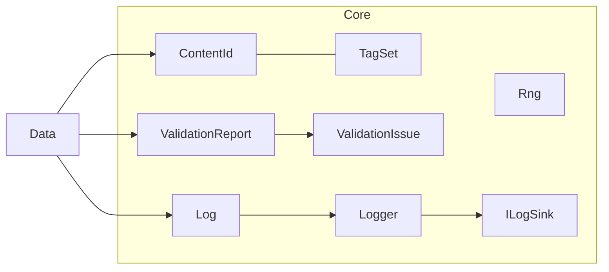

# System: Core (`Realm.Core`)

## 1. Purpose and scope
Foundation types shared by all non-Godot projects: deterministic randomness, stable IDs and tags, validation results and a logging facade. It holds no content, world state or generators and references no other Realm project.

## 2. Status
| Feature | State |
|---|---|
| `Rng` (PCG32, `ForKey`) | Implemented |
| `ContentId`, `TagSet` | Implemented |
| `ValidationIssue`, `ValidationReport`, `Severity` | Implemented |
| Logging facade (`Log`, `Logger`, `ILogSink`, null and text-writer sinks) | Implemented |
| Math types, events, serialization primitives | Planned |

## 3. Architecture

- **`Rng`**: sealed class with PCG32 state; `ForKey` builds one from a root seed plus a path of strings and integers. Not thread-safe: one instance per thread or task.
- **`ContentId`**: readonly struct wrapping a validated string such as `material.iron_ore`. Two or more dot-separated segments; each is lowercase, digits and underscores, starting with a letter. First segment is the content type. Default value is empty and safe.
- **`TagSet`**: immutable, validated tags; always enumerates in ordinal sorted order.
- **`ValidationReport`**: collects `ValidationIssue(Severity, Code, Location, Message, SuggestedFix)` in insertion order.
- **`Log`**: static facade and the one documented service locator. `Log.Sink` is process-wide and defaults to a sink that discards. `Log.For("Category")` returns a `Logger`. Logging never affects simulation results.

## 4. Data
None. `ContentId` and tag grammar are used by [content](../reference/content/material.md).

## 5. Determinism and persistence notes
- `Rng` output for a seed and stream is fixed; verified against the canonical pcg32 reference vector (seed 42, stream 54).
- `ForKey` mixes keys with SplitMix64 and FNV-1a over UTF-8, so it is stable across machines and runs. Strings and integers are type-tagged and never collide; integer types of equal value hash equally.
- Any change to those algorithms reshuffles every generator. `ForKey_IsStableGolden` guards it. If you change it on purpose, bump generator versions and regenerate goldens.
- `ContentId` comparison and ordering are ordinal. `TagSet` order is sorted. Both are safe in generator output.
- Nothing from Core is saved yet; saves will reference content by `ContentId` string.

## 6. Extension points
New sinks implement `ILogSink` (Godot will provide one in M1). Everything else: none yet.

## 7. Validation
Unit tests in `tests/Realm.Core.Tests`: `RngTests`, `ContentIdTests`, `TagSetTests`, `ValidationReportTests`, `LoggingTests`.

## 8. Performance notes
`Rng.NextUInt32` and friends do not allocate. `Rng.ForKey` allocates and is for setup, not per-tick use. `Logger` is a struct, but message strings are built by the caller even when the sink discards them, so avoid logging in hot paths. Not profiled.

## 9. Known limitations
- The `ForKey` golden was captured from this implementation, so it detects change, not correctness. Core generator correctness comes from the reference vector.
- No statistical tests of `Rng` beyond range, coverage and a coarse fairness check.
- `Log.Sink` is global state; tests that replace it must run serially and restore it.

## 10. History
- [ADR 0001](../decisions/0001-solution-skeleton.md)
- [Devlog: solution skeleton](../devlog/2026-10-20-solution-skeleton.md)
- [Devlog: Core and Data foundations](../devlog/2026-10-20-core-data-foundations.md)
