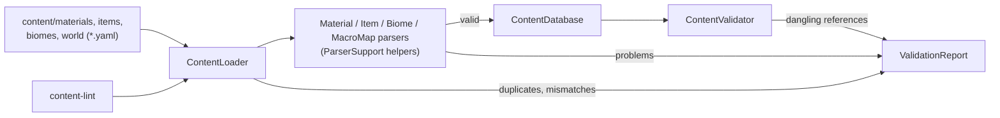

# System: Data (`Realm.Data`)

## 1. Purpose and scope
Loads hand-edited YAML content, validates it against schemas and exposes it by stable ID. Does not hold world state, run generators or interpret what content means.

## 2. Status
| Feature | State |
|---|---|
| YAML loading of `material`, `item`, `biome` and `world` (macro map) records, strict schema | Implemented |
| Duplicate ID, ID/directory mismatch, file name checks | Implemented |
| Dangling reference (`DATA013`) and wrong-type reference (`DATA014`) checks | Implemented for `item.material` and `region.biome` |
| Polygon, world size and bounds checks for the macro map (`DATA015`-`DATA017`) | Implemented |
| `content-lint` CLI command | Implemented |
| `item` and `biome` schemas beyond identity, tags and properties | Planned, needs developer design |
| Other content types (recipes, creatures, ...) | Planned |
| Mod packs, load order, override by ID | Planned (M7). Today a duplicate ID is an error. |
| Records grouped several to a file | Planned. Today one record per file. |
| Generated reference docs | Planned |

## 3. Architecture

- `ContentLoader.Load(root, report)`: visits directories and files in ordinal sorted order, loads each known type through a small `TypeSpec<T>` (directory, ID prefix, parser, ID getter), then runs `ContentValidator`. Returns a database of the valid records and puts every problem in the report. It never throws on bad content.
- `MaterialParser`, `ItemParser`, `BiomeParser`, `MacroMapParser`: YAML text to a definition or null. A new YamlDotNet deserializer is built per call, with no ignore-unmatched, so unknown fields are errors. Shared steps live in internal `ParserSupport`.
- `ContentDatabase`: immutable; `Materials`, `Items`, `Biomes`, `MacroMaps` and `Regions` (all regions of all maps) are keyed by `ContentId` in sorted order; `Contains(id)` and `TryGetSource(id)` (the file a record came from).
- `ContentValidator.ValidateReferences`: cross-record checks, run after all types are loaded so file order never matters.
- Single-threaded; no async.

## 4. Data
Consumes: [`material`](../reference/content/material.md), [`item`](../reference/content/item.md), [`biome`](../reference/content/biome.md), [`world`](../reference/content/world.md) (macro map). `item` and `biome` schemas are placeholders. Produces nothing on disk.

## 5. Determinism and persistence notes
Sorted file visiting makes issue order and "first duplicate wins" independent of the file system. Saves reference content only by `ContentId` string (Planned, M2+); nothing is saved yet.

## 6. Extension points
Step-by-step: [Add a content type](../how-to/add-a-content-type.md). In short: a definition record, a parser, a `TypeSpec` in `ContentLoader`, a `ContentDatabase` collection, reference checks, tests, a reference page and a how-to.

## 7. Validation
Codes `DATA001`..`DATA017`: [validators](../reference/validators.md). Tests: `tests/Realm.Data.Tests`, including `ShippedContentTests`, which lints the real `content/` directory.

## 8. Performance notes
Not measured. Loading is a startup cost and may allocate freely.

## 9. Known limitations
See [known issues](../known-issues.md): field-level errors have no line number; only `.yaml` files are read; unknown-field wording depends on YamlDotNet.

## 10. History
- [ADR 0003](../decisions/0003-yaml-content-loading.md), [ADR 0006](../decisions/0006-macro-map-format.md)
- [Devlog 2026-10-20 core and data](../devlog/2026-10-20-core-data-foundations.md)
