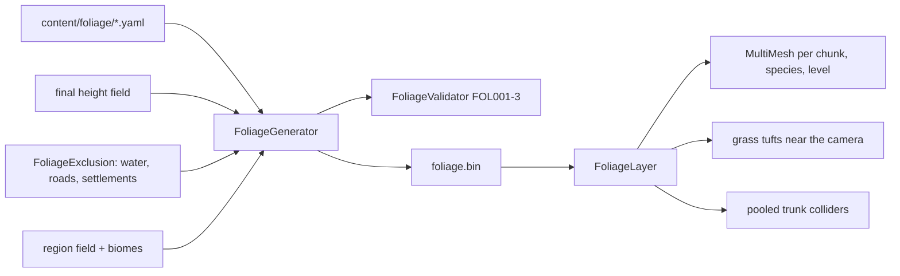

# Foliage (as built)

## 1. Purpose and scope
Scatters trees, bushes and grass over the finished world and draws them cheaply. Not included: wind, seasons, destruction, hand-made models, billboards, undergrowth props (rocks, flowers), foliage in dungeons, per-chunk streaming of the data file.

## 2. Status
| Feature | Status |
|---|---|
| `foliage` content type with per-biome density | Implemented |
| Tree and bush generator with clumping, height and slope limits, minimum spacing | Implemented |
| Exclusion of water, roads, settlements | Implemented |
| Grass density map and run-time scatter | Implemented |
| Baked `foliage.bin` | Implemented |
| Chunked MultiMesh rendering with near and far models | Implemented (placeholder models) |
| Trunk colliders (48 pooled) | Implemented |
| Wind, billboards, hand-made art, editor painting and locks | Planned |

## 3. Architecture

- `Realm.Data`: `FoliageDefinition`, `FoliageParser`, `FoliageVocabulary`.
- `Realm.Gen.Foliage`: `FoliageGenerator`, `FoliageExclusion`, `FoliageValidator`, `FoliageFile`, `GrassScatter`, `FoliageMeshes`, `FoliageSettings`.
- `Realm.Game.World.FoliageLayer`: loads the file, builds up to two chunks and two grass cells per frame, frees chunks beyond 1,000 m.
- Threading: generation is single-threaded in the CLI; the game builds on the main thread (chunks hold a few hundred plants).

## 4. Data
Consumes [`foliage`](../reference/content/foliage.md) records; produces `foliage.bin` (layout in the `FoliageFile` doc comment).

## 5. Determinism and persistence
Each candidate seeds `Rng` from the world seed, species ID and cell, so output does not depend on other species. `FoliageGenerator.GeneratorVersion` is 1. Nothing goes into saves yet.

## 6. Extension points
Add a record under `content/foliage/` ([how-to](../how-to/add-a-foliage-species.md)). Models are chosen from kind and tags in `FoliageMeshes.StyleFor`.

## 7. Validation
`FOL001` (plant where it cannot grow), `FOL002` (too close), `FOL003` (species placed nothing); `DATA013` and `DATA019` for content ([validators](../reference/validators.md)).

## 8. Performance notes
Shipped world: about 825,000 plants, 186,000 grass cells, bake step about 7 s. In the game roughly 30 chunks (850 m) are built at once; a forest view ran at 60 fps or better on the development machine in a fly-over, and over 140 fps at ground level. The soak test with frame-time percentiles is not yet written for foliage.

## 9. Known limitations
See known issues 70 and 71.

## 10. History
[ADR 0020](../decisions/0020-foliage.md), [devlog 2026-10-22 foliage slice](../devlog/2026-10-22-foliage-slice.md).
