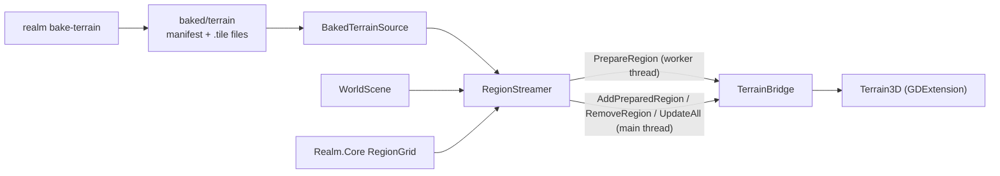

# System: Game (`Realm.Game`)

## 1. Purpose and scope
The Godot presentation layer. Today it streams baked terrain into Terrain3D and lets you walk or fly over the world, and it holds the Terrain3D streaming spike. It renders and reads input; it contains no game rules. It does not yet have vegetation, actors, UI beyond a debug HUD, audio or saves.

## 2. Status
| Feature | State |
|---|---|
| Godot 4.5.1 .NET project, Terrain3D 1.0.2 addon, architecture test for the project | Implemented |
| `TerrainBridge`: the only Terrain3D caller (version check, region add and remove, batched rebuild, colour maps) | Implemented |
| `RegionStreamer`: distance-based load set, worker-thread build, batched commit | Implemented |
| `BakedTerrainSource`, `WorldScene`: walk and fly over the baked world, HUD, sky, fog, sea plane | Implemented |
| `DayNightCycle`: world clock, sun and moon lights, sky shader with stars and moon phases, fog and ambient by time of day ([ADR 0021](../decisions/0021-day-night-cycle.md)) | Implemented |
| Clouds in the sky shader from a baked climate map: regional cover and thickness, two lit layers, wind, overhead cloud dims the light ([ADR 0022](../decisions/0022-clouds.md)) | Implemented |
| Streaming spike scene and frame-time report | Implemented |
| Auto-walk verification mode with a frame-time report | Implemented (first slice of the traversal soak test) |
| Origin rebasing, per-biome textures, water rendering, foliage, navigation, actors, sim LOD wiring | Planned |
| Full 30 minute traversal soak test with thresholds | Planned |
| `Realm.Editor` | Planned |

## 3. Architecture

- `TerrainBridge` creates the Terrain3D node, checks its version (exactly 1.0.2), and wraps every string-based call. Terrain3D allows at most 32 x 32 regions; the bridge validates coordinates. `PrepareRegion` builds the image and region objects and is safe on a worker thread (no problems seen in any run); `AddPreparedRegion` is main thread only.
- `RegionStreamer`: each frame it asks `RegionGrid.RegionsWithin` (tested in Core) which regions lie within the load distance of the camera, requests the missing ones nearest first on the thread pool (at most 3 in flight), commits finished ones, removes those beyond the unload distance, and runs **one** shared-texture rebuild for all of that frame's adds and removes. Results for regions that became unwanted are discarded. Options can be replaced between frames (the scene does this when you toggle fly).
- `WorldScene`: loads the manifest, creates the terrain, preloads the regions around the start, then each frame moves the player, streams, updates the HUD and keeps the sea plane under the camera. Walk mode is a `CharacterBody3D` (capsule 0.4 m x 1.8 m, slope limit 50 degrees) on Terrain3D dynamic collision (shape 8, radius 16: p99 3.4 ms versus 17 ms at 16/32); fly mode moves freely without collision. The 3D world renders into a SubViewport at 0.75 of the window size (`--render-scale`) and is stretched with nearest filtering; the HUD is drawn at full window resolution. Ground uses 64 px procedural grass and rock (`Realm.Gen.Textures`) through Terrain3D's auto-shader, tinted by the baked colour map. An invisible wall keeps the player 10 m inside the world edge; the sea plane covers exactly the world and nothing is drawn beyond it. `SettlementStreamer` builds the cities from `settlements.json` as the player approaches ([settlements](settlements.md)). Walk loads terrain within 300 m with thick fog; fly loads 1,600 m with thin fog.
- Threading: only the main thread touches the scene tree and Terrain3D data; the thread pool generates or reads regions and builds the region objects.
- The Godot-free pieces live elsewhere so they are tested: tile format, baker and manifest in `Realm.Gen.Bake`; `RegionGrid` and `FrameStats` in `Realm.Core`.

## 4. Data
Consumes the baked terrain ([format](../reference/baked-terrain.md)). Produces nothing.

## 5. Determinism and persistence notes
Nothing in this project affects simulation results. The world is a pure function of the baked files. Nothing is saved yet.

## 6. Extension points
New content streamed per region (vegetation, props, navigation) should follow the same pattern: build on a worker thread, commit in batches, measure frame time. Textures replace the baked colour as the main look when added.

## 7. Validation
- Dependency rules: `tests/Realm.Architecture.Tests` (Game may reference Core, Data, Sim, Gen and Scripting; nothing may reference Game; only Game uses the Godot SDK).
- Godot-side behaviour is verified by running: `--autowalk=SECONDS` (frame statistics, ground following, streaming counts) and `--screenshot` (rendered views), and by the spike. There are no automated tests of the Godot code itself yet.

## 8. Performance notes
Measured on the development machine (Intel Lunar Lake integrated GPU, Linux, Godot 4.5.1, single runs):
- Spike, 256 x 256 vertices at 4 m regions, batched rebuild, worker build, 480 m view: one rebuild costs 3.7 ms with 2 regions loaded (6.7 ms with 9 to 12); adds cost 0.1 ms and removes 0.2 to 0.7 ms on the main thread; the worst frame was 10.9 ms at 120 m/s. See [ADR 0009](../decisions/0009-terrain3d-integration-and-streaming.md).
- Walking the real world for 60 s (vsync off): median 2.4 ms, p99 3.5 ms, p99.9 4.2 to 4.5 ms; 1 to 2 frames per minute of 16 to 36 ms with no streaming step (cause unknown). With vsync on, frames are locked to the 144 Hz refresh (median 6.9 ms) and 4 to 5 frames per minute reached 44 to 52 ms; compare frame times only with vsync off.
- Region add cost grows with region size (512 vertices: rebuild 16 to 34 ms); 128 vertices is pathologically slow in Terrain3D 1.0.2.

## 9. Known limitations
See [known issues](../known-issues.md): basic walker physics (issues 38, 43), placeholder textures, rivers and lakes are painted colours, the sea is a plane, the baked colour is filtered smoothly and looks blurry up close, only Linux has been run, a few unexplained frame spikes remain.

## 10. History
- [ADR 0009](../decisions/0009-terrain3d-integration-and-streaming.md), [ADR 0010](../decisions/0010-baked-terrain-format.md), [ADR 0005](../decisions/0005-world-scale-and-seamless-streaming.md)
- [Devlog 2026-10-20 godot and streaming](../devlog/2026-10-20-godot-streaming.md)
