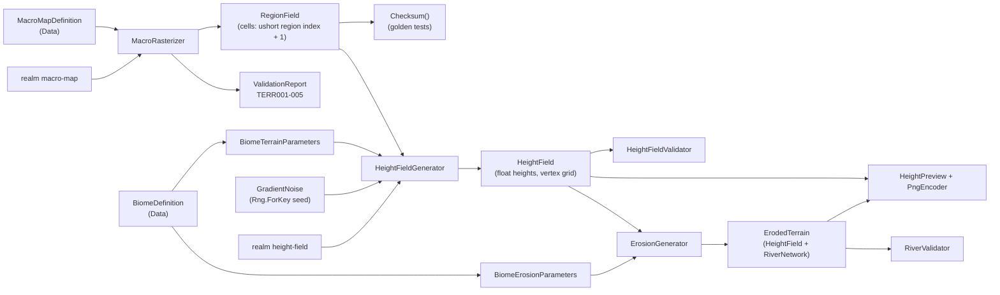

# System: Gen (`Realm.Gen`)

## 1. Purpose and scope
Generators and their validators. Today it contains the first terrain steps: turning the hand-authored macro map into a region grid (and proving every part of the world belongs to exactly one region), generating terrain heights from the regions' biomes, and eroding that terrain while finding its rivers and lakes. It does not yet contain ravines, roads, settlements, dungeons or populations, and it does not bake anything to disk.

## 2. Status
| Feature | State |
|---|---|
| Macro map rasterisation to a region grid (`MacroRasterizer`, `RegionField`) | Implemented |
| Coverage validation: gaps, overlaps, empty regions (`TERR001`-`TERR005`) | Implemented |
| Versioned generator ID, checksum for golden tests | Implemented |
| Height field from biomes: blurred parameters + gradient noise (`HeightFieldGenerator`, `HeightField`) | Implemented |
| Height-field validators: biome properties, non-finite and extreme heights, region-border seams (`TERR006`-`TERR014`) | Implemented |
| Erosion and rivers: priority-flood routing, flow accumulation with river loss, implicit stream-power carving, thermal relaxation, basin fill, rivers and lakes (`ErosionGenerator`, `ErodedTerrain`, `RiverNetwork`) | Implemented |
| Erosion and river validators (`TERR015`-`TERR017`) | Implemented |
| Preview image (`HeightPreview`: relief shading, region borders, rivers, lakes; `PngEncoder`) and `realm height-field` | Implemented |
| Burning rivers into the full-resolution terrain, water rendering, locking and hand-editing rivers | Planned |
| Chunk-aligned tile output, 16-bit storage and bake format | Planned (needs chunk size ADR, ADR 0005) |
| Ravines, settlements, roads, bridges, splat maps, foliage | Planned |
| Dungeon and population generators | Planned |
| Seed sweeps | Planned (the macro rasteriser has no seed) |

## 3. Architecture

- `MacroRasterizer.Rasterize(map, report, cellMeters = 64)`: allocates a `side x side` grid of cells (side = world size / cell size), visits regions in sorted ID order, and for each polygon tests only the cells inside its bounding box. A cell is claimed by the region whose polygon contains the cell centre. A second claim by a different region is recorded as an overlap; cells nobody claims are gaps.
- `RegionField`: immutable result. Cell value 0 means unassigned; value `n` means `Regions[n - 1]`, where `Regions` is in ordinal ID order (independent of file order). Rows run north to south, each row west to east.
- Single-threaded and synchronous; a 320 x 320 grid is trivial to compute.

**Height field** ([ADR 0007](../decisions/0007-height-field-generation.md)):
- `BiomeTerrainParameters.TryFrom(biome, report)` reads and validates `base_height_m`, `relief_m`, `roughness`, `water_depth_m`.
- `HeightFieldGenerator.Generate(map, regions, biomes, seed, settings, report)` fills three `ParameterGrid`s (base height, relief, roughness) from each cell's region biome, blurs them (two box passes, half the blend distance each), then for every vertex samples them bilinearly and computes `base + relief * fractal noise`. Rows are evaluated with `Parallel.For`; each vertex depends only on its own position, so the result does not depend on scheduling.
- `GradientNoise`: 2D gradient noise; its 256-entry lattice table is shuffled by `Rng.ForKey(worldSeed, "terrain", "height")`.
- `HeightField`: `(world / spacing + 1)` squared vertices, row by row from the north-west corner; `At`, bilinear `Sample`, `Checksum`.
- `HeightFieldValidator.Validate`: non-finite and extreme heights, and slopes across region borders.
- Tuning lives in `HeightFieldSettings` (spacing 8 m, blend 384 m, 6 octaves, wavelength 2048 m, gains 0.35 to 0.60); all are placeholders.

**Erosion and rivers** ([ADR 0008](../decisions/0008-erosion-and-rivers.md)):
- `BiomeErosionParameters.TryFrom(biome, report)` reads `rainfall`, `erodibility`, `max_slope_deg`, `river_loss` (land biomes; ocean biomes ignore them).
- `ErosionGenerator.Apply(map, regions, biomes, source, settings, report)` samples the field onto a coarse working grid (default 32 m), then per iteration: `FlowRouter` (priority-flood: fills depressions, steepest-descent receivers, downstream-first order) -> `RiverExtractor.FillSmallBasins` (fills basins that are not kept lakes) -> `FlowAccumulator` (rainfall in effective km2, losing `river_loss` per km) -> `StreamPowerEroder` (implicit step, flow exponent 0.5). After the loop it extracts rivers and lakes, applies the coarse carve to the full-resolution field by bilinear interpolation, and runs `ThermalEroder` (Jacobi relaxation; each pair's transfer depends only on that pair, so rows run in parallel with identical results) with the per-vertex stable slope from the blurred biome `max_slope_deg`.
- `RiverExtractor.ExtractRivers`: land vertices with flow at or above the threshold; sources are river vertices with no river vertex upstream, traced longest flow path first; mouths are `Sea`, `WorldEdge`, `Confluence` (joins an earlier river) or `Dried`. Lakes are connected groups of filled vertices at the same water level.
- Result `ErodedTerrain`: `Field`, `Network` (`Rivers`, `Lakes`), `MaxCarveDepthMeters`, `Checksum()`.
- Tuning lives in `ErosionSettings` (working grid 32 m, 20 iterations, strength 2, 20 thermal passes, river threshold 2 km2, lake depth 2 m, minimum lake area 4 km2, blend 384 m); all are placeholders.

## 4. Data
Consumes [`world`](../reference/content/world.md) (and indirectly [`biome`](../reference/content/biome.md) for reporting). Produces an in-memory `RegionField`; nothing is written to disk yet.

## 5. Determinism and persistence notes
- `terrain.macro_raster` v1 is identified by its version, the input map and the cell size; there is no seed. `terrain.height_field` v1 is identified by its version, the world seed, `HeightFieldSettings` and the input content (macro map and biomes). `terrain.erosion` v1 has no randomness of its own: it is identified by its version, the input height field, the biomes and `ErosionSettings`.
- Height noise comes from `Rng.ForKey(worldSeed, "terrain", "height")`. `HeightField.Checksum()` fingerprints the exact float bits; goldens are in `ShippedHeightFieldTests` (spacing 128 m, seed 1).
- Regions are numbered in sorted ID order and visited in that order, so file order never changes the result (test `RegionNumbering_FollowsSortedIdOrder_NotFileOrder`).
- `Polygon.Contains` uses a half-open rule so shared borders give each cell centre exactly one owner. Tested on borders that pass exactly through cell centres.
- `RegionField.Checksum()` fingerprints the generator version, sizes, region IDs and every cell. The golden for the shipped world is in `MacroRasterizerTests`. If the output changes on purpose, bump `GeneratorVersion`, update the golden and add a CHANGELOG note.
- Floating-point: polygon tests use doubles. Cross-machine identical results are expected for these simple operations but are not independently verified.

## 6. Extension points
New generator steps follow the same shape: a static class with a version constant, pure inputs, a `ValidationReport`, a result type with a checksum, tests with an independent oracle where possible, and a CLI command. Codes get their own prefix per generator family (`TERR` for terrain), documented in [validators](../reference/validators.md).

## 7. Validation
`tests/Realm.Gen.Tests` has 186 tests. `MacroRasterizerTests` (16): full coverage, gaps, overlaps, shared borders through cell centres, multi-polygon regions, self-overlap allowed, tiny regions, bad world size, sorted numbering, checksum behaviour, resolution change, and the shipped world.

Height field tests: `GradientNoiseTests` (range, continuity, period, statistics, golden), `BiomeTerrainParametersTests`, `ParameterGridTests` (blur symmetry, mean preserved), `HeightFieldGeneratorTests` (flat terrain has exact hand-calculated values, border is exactly the midpoint by symmetry, blend reaches the configured distance, determinism under parallel evaluation, seed behaviour, every failure path), `HeightFieldValidatorTests`, `PngEncoderTests` (standard CRC-32 vector, zlib round trip), `HeightPreviewTests` and `ShippedHeightFieldTests` (interior ranges worked out from the biome values, coast has no seam, golden).

Erosion tests (`tests/Realm.Gen.Tests/Erosion`, 92): `FlowRouterTests` (tilted plane, pit filled to its spill point, lakes, sea outlets, deterministic flats), `FlowAccumulatorTests` (flow arithmetic by hand, total flow equals total rain, loss halves flow per km), `StreamPowerErosionTests` (closed form `100 / 1.1` for one link, never rises, never cuts below the receiver, more flow carves deeper), `ThermalErosionTests` (mass conserved, symmetric spike, stable slopes reached, per-vertex limits, parallel determinism), `RiverExtractorTests` (V valley gives one river, Y junction gives a confluence, loss dries a river, sea mouth, lakes, basin fill), `BiomeErosionParametersTests`, `ErosionGeneratorTests` (sea floor untouched, no rain means no rivers, erodibility and stable slope behave, every failure path, determinism) and `ShippedErosionTests` (on the shipped world: sea floor untouched, rivers reach the sea, marsh has more river per km2 than badlands, golden).

The shipped-world oracles derive their expectations from the content instead of hard-coding the layout: region area from polygon area, height ranges from each biome's values, and "interior" vertices found by checking neighbouring cells. The macro-map shipped-world test also has an independent oracle worked by hand: the land is the square from -8000 m to 8000 m, and 8000 / 64 = 125 whole cells on each side of the centre, so land owns 250 x 250 = 62,500 cells and the sea 102,400 - 62,500 = 39,900. (An earlier version of this oracle for the old layout had an arithmetic slip, 186 instead of 188, which the test caught; the rasteriser was right.)

## 8. Performance notes
Macro rasterisation: a few milliseconds for 320 x 320 cells. Erosion (single runs on the development machine, Release): 11.5 s for the 20 km world with an 8 m field and a 32 m working grid; 6.9 s with a 32 m field. Twenty priority-flood iterations on the 641 x 641 working grid dominate; the thermal pass allocates one double per full-resolution vertex (about 52 MB at 8 m, about 840 MB at 2 m). Height field (single measurement, Release, parallel rows): the full 20 km world at 8 m spacing (6.56 million vertices, 26 MB) takes about 2.8 s; 32 m spacing about 0.3 s. At 2 m spacing the cost scales with vertex count: about 105 million vertices, roughly 16 times longer (estimate, not measured) and about 420 MB as floats. Not profiled beyond that.

## 9. Known limitations
See [known issues](../known-issues.md): regions thinner than a cell can be missed; polygons cannot have holes; the 64 m cell size is a proposal; all height and erosion tuning values are placeholders; the blend is quantised to macro cells; the seam check depends on vertex spacing; rivers are not burned into the terrain and water is not rendered; no tile or chunk output yet.

## 10. History
- [ADR 0008](../decisions/0008-erosion-and-rivers.md), [ADR 0007](../decisions/0007-height-field-generation.md), [ADR 0006](../decisions/0006-macro-map-format.md), [ADR 0005](../decisions/0005-world-scale-and-seamless-streaming.md)
- [Devlog 2026-10-20 macro map](../devlog/2026-10-20-macro-map.md), [height field](../devlog/2026-10-20-height-field.md), [erosion and rivers](../devlog/2026-10-20-erosion-and-rivers.md)
