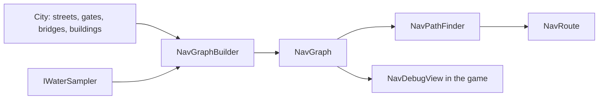

# Navigation (as built)

## 1. Purpose and scope
Walking graphs for simulated characters: the data structure and pathfinding (`Realm.Sim.Navigation`) and the builder for settlements (`Realm.Gen.Settlements.Navigation`). Not included: NPCs, schedules, interiors, travel between settlements, steering and avoidance of other characters.

## 2. Status
| Feature | Status |
|---|---|
| `NavGraph`, `NavPathFinder` (A*), `NavRoute` | Implemented |
| Settlement graph builder (square ring, streets, gates, bridges, doors, lanes) | Implemented |
| Validators `NAV001`, `NAV002` | Implemented |
| Debug drawing (N, `--nav-debug`) | Implemented |
| `OpenGround` (what a character on foot can stand on or walk across) | Implemented |
| `WorldNavBuilder`: settlement graphs joined by the roads into one world graph, `NAV003` | Implemented |
| Interiors, characters travelling between settlements | Planned |

## 3. Architecture

The world graph (`WorldNavBuilder`) copies each settlement graph into world coordinates and adds the roads: every road point is a node, bridge spans are bridge edges, road ends join the outside nodes beyond the gates, and roads that meet join each other.

Dependency rule: the graph types live in Sim (Core, Data, Sim are below Gen); only the builder, which needs the generated `City`, is in Gen.

## 4. Data
The graph is built in the city's plan frame (central square at the origin); `Settlement.ToWorld` converts to world metres. It is not baked: building a 250-house city takes about 0.2 s.

## 5. Determinism and persistence
Pure functions of the city and the water sampler; fixed iteration orders; ties by node ID. Nothing goes into saves (the graph is regenerated from the settlement's seed and parameters).

## 6. Extension points
New node kinds in `NavNodeKind`; further obstacles in `NavGraphBuilder.Blocked`.

## 7. Validation
`NAV001`, `NAV002` ([validators](../reference/validators.md)); the shipped-world test builds all 13 graphs and requires no issues.

## 8. Performance notes
Builder: 0.2 s for a city of 250 houses, 0.03 s for a town. A search on a city graph (about 350 nodes) is microseconds; the finder reuses its arrays.

## 9. Known limitations
See known issue 75.

## 10. History
[ADR 0023](../decisions/0023-settlement-walking-graph.md), [devlog 2026-10-23](../devlog/2026-10-23-street-graph.md).
