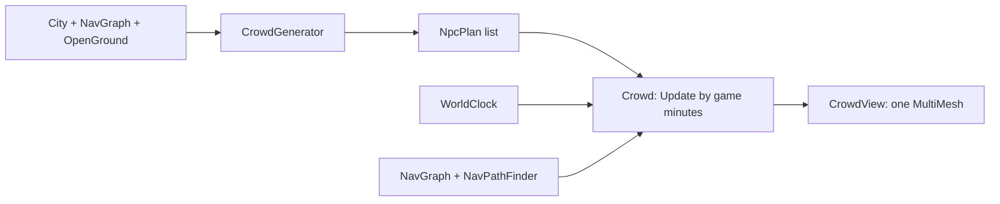

# Characters and crowds (as built)

## 1. Purpose and scope
Simulated characters in settlements: plans from the generator, a day for each of them on the walking graph, and a capsule view. Not included: identity (names, traits, needs, relationships), tasks, dialogue, interiors, collision with the player, characters outside settlements, saves.

## 2. Status
| Feature | Status |
|---|---|
| `NpcPlan`, `Crowd` (standing, walking, inside; sleep at night; catch-up after a time jump) | Implemented |
| `CrowdGenerator` (guards, loiterers round the fountain, walkers with homes and destinations) | Implemented |
| `CrowdView` (capsules in one MultiMesh) | Implemented (placeholder look) |
| World walking graph joined by the roads (`WorldNavBuilder`) | Implemented (not yet used by characters) |
| Travel between settlements, real figures, interiors, needs and tasks | Planned |

## 3. Architecture

Simulation (`Realm.Sim.Npcs`) knows nothing of the generator or Godot; the generator (`Realm.Gen.Population`) produces plans; `CityInstance` owns the crowd and the view.

## 4. Data
Plans are generated when a settlement is built (a few milliseconds) and are not baked or saved. Counts: 220 per city, 40 per town, 12 per hamlet (`CrowdSettings`); `--crowd-scale` scales them.

## 5. Determinism and persistence
Plans and every later choice come from `Rng` (plan seed per character); two crowds with the same plans on the same graph and the same times give the same positions. Nothing is saved yet: on load the crowd starts mid-day from the clock.

## 6. Extension points
New roles in `NpcRole` and `Crowd.Decide`; per-tier counts in `CrowdSettings`; a `lineClear` delegate for open-ground tests.

## 7. Validation
Tests cover the generator (counts, roles, spots on open ground and thickest by the fountain, homes and destinations reachable, determinism) and a simulated day of 220 characters (nobody in the fountain, the square full by day, the streets empty at night).

## 8. Performance notes
`Crowd.Update` visits each character once per frame and does work only for those whose next event is due; a path search is microseconds. `CrowdView` writes one transform and colour per visible character. The crowd is not updated or drawn while the player is more than 450 m from the city wall.

## 9. Known limitations
Known issues 75 and 76.

## 10. History
[ADR 0023](../decisions/0023-settlement-walking-graph.md), [ADR 0024](../decisions/0024-crowd-of-capsules.md), [devlog 2026-10-23 crowd](../devlog/2026-10-23-crowd-of-capsules.md).
