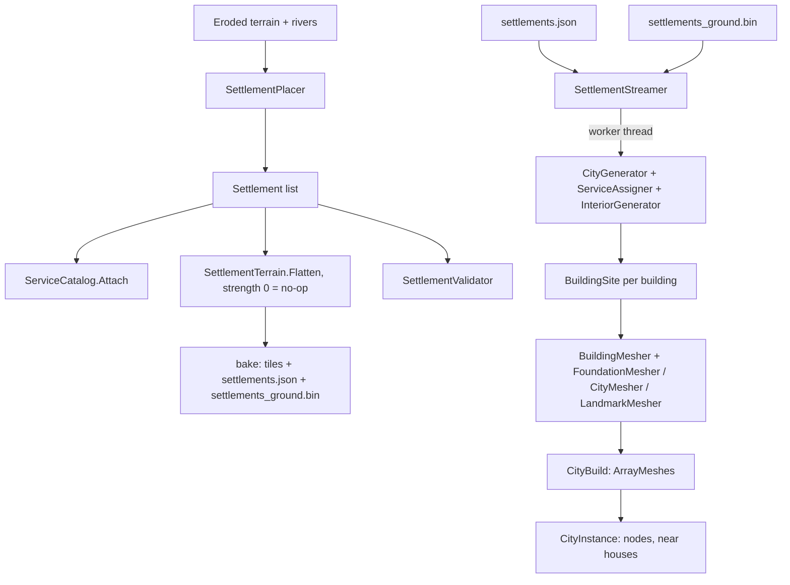

# Settlements (cities and towns)

## 1. Purpose and scope
Generates walled cities and towns, places them on the natural terrain (nothing is flattened), puts the service buildings in them, builds their 3D geometry on sloping ground with foundations, and places one extra city in the mountains ([ADR 0014](../decisions/0014-cities-on-natural-ground-and-service-buildings.md)). The city generator is imported from the developer's CityGen project ([ADR 0012](../decisions/0012-city-generator-import-and-placement.md)). Also builds the roads between settlements ([ADR 0013](../decisions/0013-roads-and-bridges.md)). Not covered: people, shops, quests, simulation (later milestones).

## 2. Status
| Feature | Status |
|---|---|
| City plan: Voronoi wards, wall, gates, streets, lots, buildings, centrepiece | Implemented (imported) |
| Building interiors: rooms, doors, windows, stairs | Implemented (imported) |
| Wider rivers with a wobble; a river city that a river runs through (houses on both banks, bank buffer, one or two arched stone bridges) | Implemented |
| Layouts: radial wards, and for small settlements (hamlets, at most 24 houses) a cross of streets with arms of different length where the houses thin out away from the crossroads (`CrossLayoutGenerator`); a second row of houses behind the first; waterfront sites with the wall cut at the water, houses kept out of it | Implemented |
| Fortification by tier: stone wall with towers (city), wooden palisade of overlapping round logs (two staggered rows, varying thickness and height, flat tops, sunk into the ground, no gaps) with wooden gate towers (town), none (hamlet); hamlet tier (at most 12 slum-style houses, lowland) | Implemented |
| Placement of 3 cities, 1 mountain city, 5 towns and 5 hamlets on the natural ground (relief limit 0.2 x radius, 0.35 for the mountain city); optional soft flattening (`FlattenStrength`, default 0); validators SETL001-006 | Implemented |
| Service buildings from `content/services/` per tier, inside the wall (ward rank, nearness, spread) and outside it (farm buildings); sign over the door; validators SETL007-009 | Implemented |
| Two building styles: `Rich` (plaster, half-timber, 30 cm walls, several rooms and storeys) in every ward except slums, and `Slum` (mud walls and dark roof in flat colours, 15 cm walls, one storey, one room, at most one window, about a third of the floor area) in slum wards and on farmland; solid 15 cm interior walls and 30 cm floor and ceiling slabs in all of them | Implemented |
| Ground grid baked per settlement; wall, towers and centrepiece laid over the terrain (no ground or street mesh: houses stand on the natural terrain, paths come later); per-building floor height; stone plinth, wooden pilings, pier with deck, door steps | Implemented |
| Baked `settlements.json`; player spawns in the first city | Implemented |
| 3D: far houses, near houses with interiors and collision, wall, gates, centrepieces, interior lamps | Implemented (first pass) |
| Generated names (placeholder); roads (A* with slope and river costs, graded into the terrain, painted), bridges, `roads.json`, world map (M), HUD with the nearest settlement | Implemented |
| Textures, time of day, window glow, animated fire, door opening, hamlets, road junction design | Planned / not ported |

## 3. Architecture

- `Realm.Gen/Settlements/Geometry`: `Vec2`, `ConvexPoly` (convex polygon with a tag per edge, clipping, inset), `Voronoi`.
- `Realm.Gen/Settlements/Model` and `Generation`: `City`, `Patch`, `Building`, `Street`, `Landmark`, `Interior` and its parts; `CityGenerator.Generate(CityParams)` and `InteriorGenerator.Generate(building, citySeed)`. Pipeline: spiral of sites, Lloyd-relaxed Voronoi patches, the `wardCount` innermost patches form the walled core, wall and gates, streets by Dijkstra from the central square, wards, lots split into buildings, each lot then reduced to the largest rectangle with its front on the street edge (`FitRectangle`; every floor plan is a rectangle, neighbours stand at least 2.8 m apart). Slum wards are cut into lots of about 34 m2 and get dwellings of at most about 4.2 to 5.8 m x 3.6 to 5.2 m. With `MaxBuildings` the city is made of whole wards: it takes the largest ward count whose houses fit under the cap (a handful of builds from a guess of 13 houses per ward), so the wall, which is the outline of the wards, hugs the outermost houses and no ward is left bare; the count lands under the cap by up to a ward's worth (about 233 to 250 of 250, 40 to 50 of 50). Settlements have no parks (`CityParams.Parks` off) so no ward is left empty except the market square. With `MaxBuildings` the city is grown to about that size and the excess trimmed outermost first.
- `Realm.Gen/Settlements/Placement`: `SettlementPlacer`, `Settlement`, `SettlementSettings`, `WaterMask`, `SettlementTerrain`, `SettlementValidator`, `SettlementManifest`, `SettlementCodes`, `ServiceCatalog` (content records to `ServiceSpec`s), `ServiceValidator`, `GroundGrid` and `GroundGridFile` (the baked terrain around a city).
- `Realm.Gen/Settlements/Generation/CrossLayoutGenerator`: the cross layout, used for small settlements only (at most `SettlementSettings.SmallSettlementMaxBuildings` = 24 houses, the hamlets; cities and towns are radial). The chance of a house falls along each arm (row 1 from 1 to 0.3, row 2 gone by 55 percent of the arm), so the settlement thins out away from the crossroads; a hamlet (humble) has shallow rows and a smaller square (about 42 m) and short arms. Strips of houses (one patch per arm, side and ward zone) play the part of wards, so everything downstream treats it like a radial city. The arm lengths come from random shares of a total scaled until the houses fit under the cap; the wall is a 16-vertex plus-shaped outline with a gate vertex in the middle of each arm's end; farmland patches beside and beyond the arms hold the farm buildings.
- `Realm.Gen/Settlements/Generation/ServiceAssigner`: runs at the end of `CityGenerator.Build` on its own random stream. Inside the wall a service takes over an existing lot (score = ward rank + distance to the square, a gate or the wall / 250 m + a penalty for another of the same service within 120 m + a little jitter; fussy services choose first); outside the wall it builds a new house on a farmland patch next to the wall, front facing the city, clear of the gates. `Building.Service` holds the spec; `InteriorGenerator` gives the main room its type.
- `Realm.Gen/Settlements/Roads`: `RoadPlanner` (links, A*, smoothing, grading, bridge spans), `RoadTerrain` (carve), `RoadValidator`, `RoadManifest`, `RiverRaster`, `Road`, `RoadBridge`, `RoadSettings`, `RoadCodes`; `Meshing/BridgeMesher` (timber deck, end ramps, rails and stone abutments built to the ground; `BuildParts` splits timber from stone so the game can texture the wood) and `Meshing/ArchBridgeMesher` (with the same end ramps). `SettlementNamer` is in `Placement`.
- `Realm.Gen/Settlements/Meshing`: `BuildingMesher` (`Far`, `Near`), `CityMesher` (stone wall or palisade, and centrepiece; no ground mesh), `LandmarkMesher`, `SettlementPalette`, `IGroundSampler` (`FlatGround`, `SettlementGround`), `BuildingSite` (floor height and foundation style) and `FoundationMesher` (plinth, pilings, pier, steps). They use `Realm.Gen.Props.PropMeshBuilder` (flat-coloured triangles, wound counter-clockwise outward; an internal helper gained `Facing*`, `OrientedBox`, `Prism`, `Tube`, `Lathe`).
- `Realm.Game/World/Settlements`: `SettlementStreamer`, `CityInstance`, `CityBuild`, `CityMaterials`, `RoadsLayer` (bridges); `Realm.Game/World/WorldMap` (map screen); `Bridge/PropMeshConverter` converts meshes to Godot (reverses winding because Godot's front faces are clockwise).

Threading: city generation, interiors, mesh building and Godot `ArrayMesh`/collision-shape creation run on worker threads (`Task.Run`); nodes are added on the main thread, 40 houses per frame. A city appears about 2 s after the player comes within the load distance (800 m walking, about 2 km flying; 250 houses, measured).

## 4. Data
Reads the final terrain and rivers and the [`service`](../reference/content/service.md) content records; writes [`settlements.json`, `settlements_ground.bin`, `roads.json` and `map.png`](../reference/settlements.md) and the road-graded terrain tiles. Settlement settings are still code constants; a content record for them is a later step.

## 5. Determinism and persistence notes
`settlement.placement` v3 is identified by its version, world seed, settings and input terrain. City seeds: `Rng.ForKey(worldSeed, "settlement", tier, index)`. The city plan uses `Rng.ForKey(citySeed, "city")` (the landmark `"city", "landmark"`, the services `"city", "services"`, interiors `"interior"` with a seed mixed from the city seed and building ID). Mesh builders are pure. Golden checksum: `ShippedSettlementTests` (128 m grid). Nothing is stored in saves yet; settlement state (shops, residents) will be deltas keyed by settlement ID.

## 6. Extension points
Change counts, sizes, spacing and the rest in `SettlementSettings` (also `--cities` and `--towns` on the CLI). Add a settlement tier by adding an enum value and a branch in `SettlementPlacer`. New centrepieces go in `CentrepieceKind` and `LandmarkMesher`. A new service building is a YAML file ([how-to](../how-to/add-a-service-building.md)); a new foundation style is a `FoundationStyle` value, a branch in `BuildingSite.ChooseStyle` and one in `FoundationMesher.Add`.

## 7. Validation
`SETL001` to `SETL009` and `ROAD001` to `ROAD006` ([validators](../reference/validators.md)): spacing, relief and height range, no water on the pad, enough placed, manifest valid, every service present, in the right place and big enough. Tests: `ServiceBuildingTests` (seed sweep over both tiers), `UnevenGroundTests` (floors never below the ground, foundations reach the lowest ground, steps, wall and landmark, ground grid file). The imported generator is covered by the ported CityGen tests; the meshers by oracle tests (wall area equals length x height minus the openings, floors equal the rooms minus the stairwell, normals face outward or into rooms, the stair ramp climbs one storey).

## 8. Performance notes
Generating a 250-house city plus all interiors and far meshes: about 2 s on a worker thread (most of it the roughly 50 farm and slum extras and the interiors). Walking through a built city: median 4.0 ms, p99 7.2 ms, with occasional 15 to 40 ms frames when a city's nodes attach. A far house is 20 to 1,500 triangles (half-timbering is most of it); a city is a few hundred thousand triangles and 1,200 mesh nodes. Detailed houses: two at a time on worker threads, a lamp per storey. A foundation adds about 100 to 200 triangles to a house with a stone plinth and a few hundred to one with pilings; a 253-house city built in 2.1 s (single screenshot runs, not a soak test).

## 9. Known limitations and TODOs
See [known issues](../known-issues.md) 47 to 52 and 54 to 58: no textures or night lighting, interior lamps have no shadows so they light a little of the street, doors are solid-looking but have no collision (you walk through them), road junctions are not designed, far houses have no collision, the placement is a placeholder, and the imported generator is a copy that does not follow CityGen's repository.

## 10. History
[ADR 0012](../decisions/0012-city-generator-import-and-placement.md), [ADR 0013](../decisions/0013-roads-and-bridges.md), [ADR 0014](../decisions/0014-cities-on-natural-ground-and-service-buildings.md), [devlog 2026-10-21](../devlog/2026-10-21-cities.md), [devlog 2026-10-22](../devlog/2026-10-22-slopes-services-mountain-city.md).
