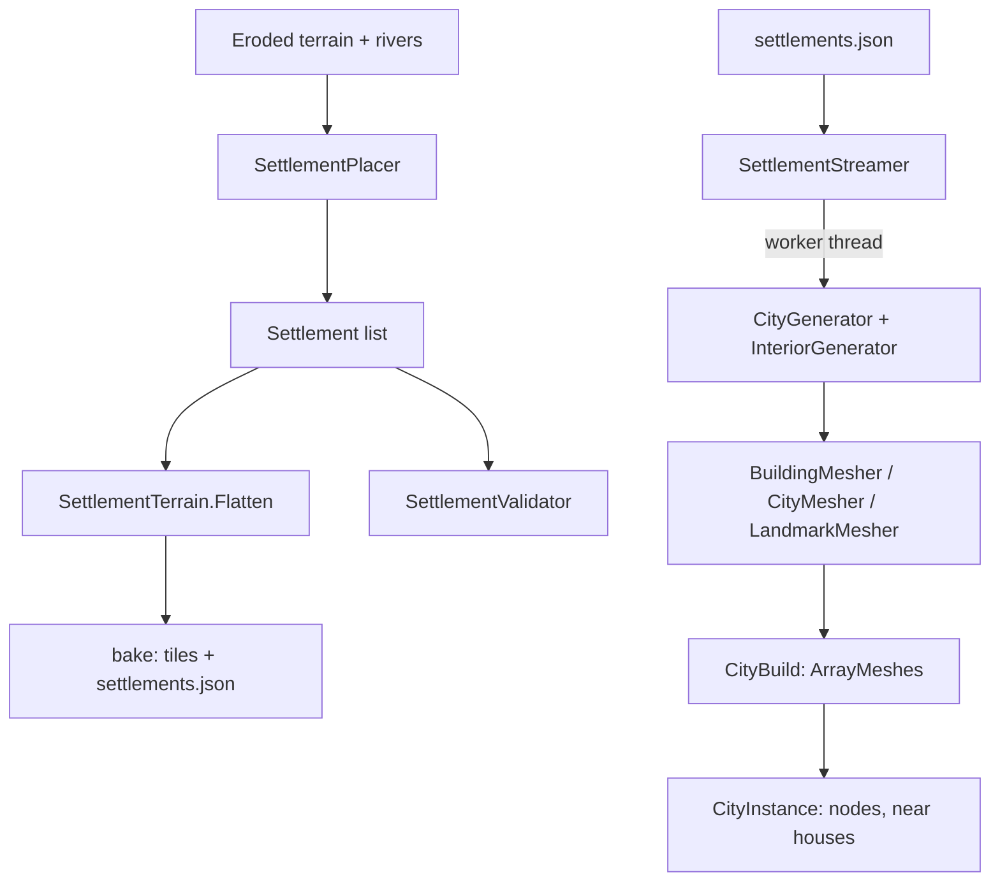

# Settlements (cities and towns)

## 1. Purpose and scope
Generates walled cities and towns, places them on the terrain, flattens the ground under them, and builds their 3D geometry. The city generator is imported from the developer's CityGen project ([ADR 0012](../decisions/0012-city-generator-import-and-placement.md)). Also builds the roads between settlements ([ADR 0013](../decisions/0013-roads-and-bridges.md)). Not covered: people, shops, quests, simulation (later milestones).

## 2. Status
| Feature | Status |
|---|---|
| City plan: Voronoi wards, wall, gates, streets, lots, buildings, centrepiece | Implemented (imported) |
| Building interiors: rooms, doors, windows, stairs | Implemented (imported) |
| Placement of 3 cities and 5 towns on flat land; terrain flattening; validators SETL001-006 | Implemented |
| Baked `settlements.json`; player spawns in the first city | Implemented |
| 3D: far houses, near houses with interiors and collision, ground, streets, wall, gates, centrepieces, interior lamps | Implemented (first pass) |
| Generated names (placeholder); roads (A* with slope and river costs, graded into the terrain, painted), bridges, `roads.json`, world map (M), HUD with the nearest settlement | Implemented |
| Textures, time of day, window glow, animated fire, door opening, hamlets, road junction design | Planned / not ported |

## 3. Architecture

- `Realm.Gen/Settlements/Geometry`: `Vec2`, `ConvexPoly` (convex polygon with a tag per edge, clipping, inset), `Voronoi`.
- `Realm.Gen/Settlements/Model` and `Generation`: `City`, `Patch`, `Building`, `Street`, `Landmark`, `Interior` and its parts; `CityGenerator.Generate(CityParams)` and `InteriorGenerator.Generate(building, citySeed)`. Pipeline: spiral of sites, Lloyd-relaxed Voronoi patches, the `wardCount` innermost patches form the walled core, wall and gates, streets by Dijkstra from the central square, wards, lots split into buildings. With `MaxBuildings` the city is grown to about that size and the excess trimmed outermost first.
- `Realm.Gen/Settlements/Placement`: `SettlementPlacer`, `Settlement`, `SettlementSettings`, `WaterMask`, `SettlementTerrain`, `SettlementValidator`, `SettlementManifest`, `SettlementCodes`.
- `Realm.Gen/Settlements/Roads`: `RoadPlanner` (links, A*, smoothing, grading, bridge spans), `RoadTerrain` (carve), `RoadValidator`, `RoadManifest`, `RiverRaster`, `Road`, `RoadBridge`, `RoadSettings`, `RoadCodes`; `Meshing/BridgeMesher`. `SettlementNamer` is in `Placement`.
- `Realm.Gen/Settlements/Meshing`: `BuildingMesher` (`Far`, `Near`), `CityMesher`, `LandmarkMesher`, `SettlementPalette`. They use `Realm.Gen.Props.PropMeshBuilder` (flat-coloured triangles, wound counter-clockwise outward; an internal helper gained `Facing*`, `OrientedBox`, `Prism`, `Tube`, `Lathe`).
- `Realm.Game/World/Settlements`: `SettlementStreamer`, `CityInstance`, `CityBuild`, `CityMaterials`, `RoadsLayer` (bridges); `Realm.Game/World/WorldMap` (map screen); `Bridge/PropMeshConverter` converts meshes to Godot (reverses winding because Godot's front faces are clockwise).

Threading: city generation, interiors, mesh building and Godot `ArrayMesh`/collision-shape creation run on worker threads (`Task.Run`); nodes are added on the main thread, 40 houses per frame. A city appears about 1.7 s after the player comes within the load distance (800 m walking, about 2 km flying; 1,200 houses, measured).

## 4. Data
Reads the final terrain and rivers; writes [`settlements.json`, `roads.json` and `map.png`](../reference/settlements.md) and the flattened and graded terrain tiles. No new content type yet (settings are code constants; a content record is a later step).

## 5. Determinism and persistence notes
`settlement.placement` v2 is identified by its version, world seed, settings and input terrain. City seeds: `Rng.ForKey(worldSeed, "settlement", tier, index)`. The city plan uses `Rng.ForKey(citySeed, "city")` (the landmark `"city", "landmark"`, interiors `"interior"` with a seed mixed from the city seed and building ID). Mesh builders are pure. Golden checksum: `ShippedSettlementTests` (128 m grid). Nothing is stored in saves yet; settlement state (shops, residents) will be deltas keyed by settlement ID.

## 6. Extension points
Change counts, sizes, spacing and the rest in `SettlementSettings` (also `--cities` and `--towns` on the CLI). Add a settlement tier by adding an enum value and a branch in `SettlementPlacer`. New centrepieces go in `CentrepieceKind` and `LandmarkMesher`.

## 7. Validation
`SETL001` to `SETL006` and `ROAD001` to `ROAD006` ([validators](../reference/validators.md)): spacing, level pad above sea level, no water on the pad, enough placed, manifest valid. The imported generator is covered by the ported CityGen tests; the meshers by oracle tests (wall area equals length x height minus the openings, floors equal the rooms minus the stairwell, normals face outward or into rooms, the stair ramp climbs one storey).

## 8. Performance notes
Generating a 1,200-house city plus all interiors and far meshes: about 1.7 s on a worker thread. Walking through a built city: median 4.0 ms, p99 7.2 ms, with occasional 15 to 40 ms frames when a city's nodes attach. A far house is 20 to 1,500 triangles (half-timbering is most of it); a city is a few hundred thousand triangles and 1,200 mesh nodes. Detailed houses: two at a time on worker threads, a lamp per storey.

## 9. Known limitations and TODOs
See [known issues](../known-issues.md) 47 to 52: no textures or night lighting, interior lamps have no shadows so they light a little of the street, doors are solid-looking but have no collision (you walk through them), road junctions are not designed, far houses have no collision, the placement is a placeholder, and the imported generator is a copy that does not follow CityGen's repository.

## 10. History
[ADR 0012](../decisions/0012-city-generator-import-and-placement.md), [devlog 2026-10-21](../devlog/2026-10-21-cities.md).
