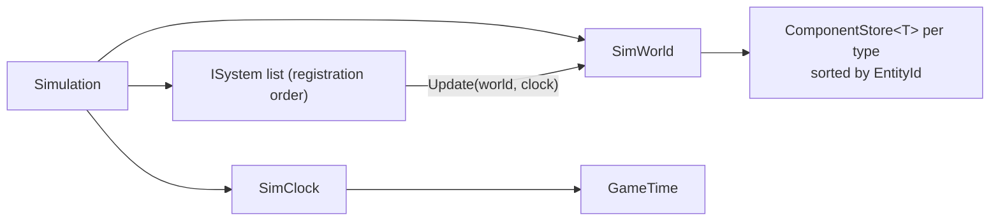

# System: Sim (`Realm.Sim`)

## 1. Purpose and scope
The tick-driven simulation core: a clock, entities with components, and systems that run each tick. It references only Core and Data and never Godot. It does not yet contain any game rules, NPCs, economy, combat, saves or simulation LOD.

## 2. Status
| Feature | State |
|---|---|
| `SimClock`, `GameTime`, `TimeSettings` (integer ticks to minutes, 24-hour day) | Implemented |
| `EntityId` (increasing, never reused), `SimWorld` with struct components | Implemented |
| `ISystem`, `Simulation` (ordered systems, tick loop) | Implemented |
| Dense component storage, allocation-free span iteration (ADR 0004) | Implemented |
| `tools/Realm.Bench` benchmark with budget check | Implemented |
| Calendar above days (weeks, months, seasons) | Planned, needs developer design |
| Day length / pacing | Decided: 20 ticks per game minute, 24 real minutes per day at 20 Hz |
| Save/load of world state and deltas | Planned (M2) |
| Multi-component queries, per-zone ticking (sim LOD) | Planned |
| `Realm.Sim.World.TerrainSampler`, NPCs, tasks, economy, crafting, combat | Planned |

## 3. Architecture

One tick, in this order: every system's `Update` runs in registration order, then the clock advances. So the first tick sees `Clock.Tick == 0`.

- `Simulation`: owns `WorldState` (a `SimWorld`), `Clock` and the systems. Property is `WorldState`, not `World`, because `Realm.Sim.World` is reserved as a namespace (CLAUDE.md section 5).
- `SimWorld`: creates and destroys entities, stores components by type, and answers queries.
- `TimeSettings.TicksPerGameMinute`: how many ticks make one game minute. The tick rate itself belongs to the host (Godot or the CLI); Sim only counts ticks.
- Single-threaded; no async (CLAUDE.md section 8.2).

## 4. Data
None. Sim does not read content yet.

## 5. Determinism and persistence notes
- Time is integers only: `GameTime.TotalMinutes = Tick / TicksPerGameMinute`.
- Entity IDs increase and are never reused, so an ID in a save cannot later mean a different entity.
- Queries, spans and `Entities` return entity order. Systems run in registration order. See [determinism](../explanation/determinism.md).
- Randomness: systems derive generators with `Rng.ForKey(world.Seed, "system", name, clock.Tick)`. The test `SameSeed_SameTicks_GiveIdenticalWorlds` and `RunInDifferentChunks_GivesTheSameResult` check this end to end.
- Nothing is saved yet. Planned: entity IDs and component deltas keyed by stable IDs, per region (CLAUDE.md section 4.5).

## 6. Extension points
Implement `ISystem` and register it: [Add a system](../how-to/add-a-system.md). New component types need no registration; any `struct` works.

Iteration API for system authors, fastest first: `EntitiesWith<T>()` with `ComponentsOf<T>()` (spans, in-place, allocation-free); `Query<T>()` (a copy; fine for non-hot code); `TryGet`/`Set` for single entities.

## 7. Validation
`tests/Realm.Sim.Tests`: `TimeTests`, `SimWorldTests`, `SimulationTests`. The simulation validators from CLAUDE.md section 7.3 do not exist yet.

## 8. Performance notes
Decision and rationale: [ADR 0004](../decisions/0004-dense-component-storage.md). How to repeat the numbers: [Profile the simulation](../how-to/profile-the-simulation.md).

**Current design** (since 2026-10-20): `ComponentStore<T>` keeps two parallel arrays sorted by `EntityId`; the living-entity list is a sorted array. For per-tick loops use `SimWorld.EntitiesWith<T>()` and `ComponentsOf<T>()` (spans, no allocation, no lookups). `Query`, `Set`, `TryGet` remain for code that is not hot.

**After the change** (`tools/Realm.Bench`, Release, 10,000 entities, two systems, single run): span in place **0.018 ms/tick**, 0 B/tick; old-style `Query` + `Set` 4.2 ms/tick, 320 KB/tick. The legacy path improved only slightly because `Set` now does two binary searches (alive check, then the store). Use spans in hot code.

### Profile that led to the change
Profiled on 2026-10-20 (Release build, .NET 8.0.131, workstation GC, single thread, one run per figure, so treat as indicative, not exact), on the original `SortedDictionary` design with `Query<T>()` copying to a new list.

**Allocation.** Exactly 16 B per entity per query (8 B `EntityId` + 8 B component, for the test component). Gen0 collections: 0 per 1,000 ticks at 100 entities, about 2 to 5 at 1,000, 45 to 95 at 10,000. Allocation exists but is modest.

**Time per system-tick** (query + `Set` each entity, one component type):

| Entities | Current | Dense + new list, `Set` by ID | Dense + reused buffer, `Set` by ID | Dense, index-based in place |
|---|---|---|---|---|
| 1,000 | 0.28 ms | 0.13 ms | 0.07 ms | 0.02 ms |
| 10,000 | 2.5 ms | 1.0 ms | 0.9 ms | 0.04 ms |

("Dense" = parallel arrays sorted by entity ID with binary search. The first column is the original design; the other columns were scratch prototypes, and the last one is what was implemented.)

**Where the time goes at 10,000 entities** (current design): the query copy is 0.31 ms; `Set` for every entity is 2.2 ms; `TryGet` for every entity is 1.3 ms. The cost is per-entity tree lookups, not the copy.

**Conclusions.**
- Removing the allocation alone (reused buffer) barely changes time (1.0 to 0.9 ms). The allocation is a GC-pressure concern, not the speed bottleneck.
- Replacing per-entity lookups with index-based in-place iteration is about 60 times faster than the current design and allocates nothing.
- Budget: the sim tick must stay at or below 4 ms (CLAUDE.md section 4.8). The original design exceeded it with two systems over 10,000 entities.
- Dense storage trade-off: adding a component to an older entity inserts in the middle (O(n)). Building 10,000 components in ID order took 0.8 ms; in reverse order, 22.6 ms (a worst case at setup, not per tick).

Status: resolved by ADR 0004. See [known issues](../known-issues.md) item 10 for what remains.

## 9. Known limitations
See [known issues](../known-issues.md): spans are invalidated by structural changes, `Query` snapshots can list entities destroyed meanwhile, the legacy `Set` path costs two binary searches, no calendar above days, struct-only components, no multi-component join.

## 10. History
- [ADR 0004](../decisions/0004-dense-component-storage.md)
- [Devlog 2026-10-20 Sim query profiling](../devlog/2026-10-20-sim-query-profiling.md)
- [Devlog 2026-10-20 Sim foundations](../devlog/2026-10-20-sim-foundations.md)
